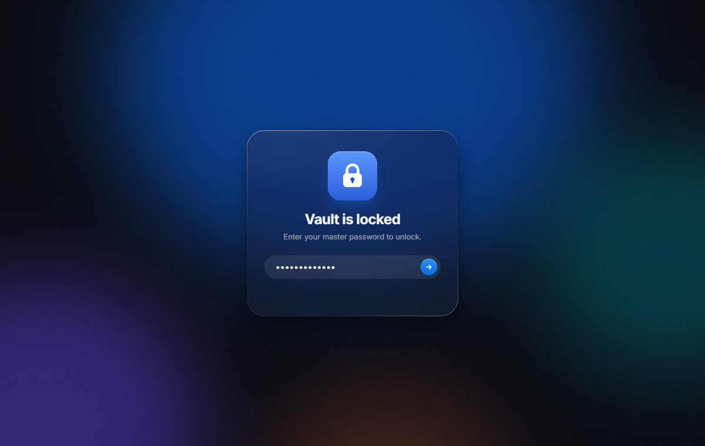

# Vault

A private, offline password manager for Windows, styled after Apple's Liquid Glass design.

<p align="center">
  
</p>

## A look around

<table>
  <tr>
    <td width="50%"></td>
    <td width="50%"></td>
  </tr>
  <tr>
    <td align="center"><b>Dark mode.</b> The background picks up each account's colour.</td>
    <td align="center"><b>Instant search</b> across names, emails, sites and notes.</td>
  </tr>
  <tr>
    <td width="50%"></td>
    <td width="50%"></td>
  </tr>
  <tr>
    <td align="center"><b>Editing.</b> Strong password suggestions, extra fields and a login link made from the site name.</td>
    <td align="center"><b>Import</b> from Apple Passwords, Chrome, Bitwarden, 1Password and more.</td>
  </tr>
  <tr>
    <td colspan="2"></td>
  </tr>
  <tr>
    <td colspan="2" align="center"><b>Locked</b> after 5 minutes idle, or when Windows locks or sleeps.</td>
  </tr>
</table>

<sub>Screenshots use made-up demo accounts. Regenerate them with <code>npm run screenshots</code>.</sub>

## Download

Get the latest version from **[Releases](../../releases/latest)**:

- **Vault-Setup-x.y.z.exe**: installs Vault and keeps it up to date automatically.
- **Vault-Portable-x.y.z.exe**: no install. Keep it on a USB stick; your encrypted vault is stored in a `Vault Data` folder next to it.

Vault isn't code-signed yet, so Windows may say *"Windows protected your PC"* the first time. Click **More info → Run anyway**.

## Features

- Instant search across names, emails, websites and notes
- **Quick search from anywhere**: press <kbd>Ctrl</kbd>+<kbd>Shift</kbd>+<kbd>Space</kbd> in any app, type a few letters and press <kbd>Enter</kbd> to copy the password (<kbd>Shift</kbd>+<kbd>Enter</kbd> user name, <kbd>Alt</kbd>+<kbd>Enter</kbd> 2FA code, <kbd>Ctrl</kbd>+<kbd>Enter</kbd> open the site). Vault keeps running in the notification area when you close the window.
- **Verification codes (2FA)**: paste a site's setup key and Vault shows the live 6-digit code, like an authenticator app
- **Security**: flags weak, reused and year-old passwords, with a button to the site's login page to change them
- **Favorites** pinned to the top, and **Recently Deleted**: deleted accounts can be recovered for 30 days
- **Password history**: the last 10 passwords of each account are kept when you change it
- User name, password, website, notes, plus your own extra fields (tokens, PINs, recovery codes) that can be hidden like passwords
- Login links made automatically: type `netflix.com` or just "Netflix" and **Open Login Page** opens the sign-in page in your default browser
- Password generator: Apple-style (`xkvbqe-Tmwz4h-pnrcdu`), fully random (length and symbols), or easy-to-type words
- Import from Apple Passwords, Chrome/Edge, Firefox, Bitwarden (CSV/JSON), 1Password, LastPass, Proton Pass, KeePass, Dashlane
- Export to CSV or JSON, and encrypted backup and restore
- Light and dark mode, keyboard shortcuts, right-click menus

## Browser extension

Fill logins in Chrome, Edge, Brave or Firefox. The extension keeps no passwords: it asks Vault for one only when you fill.

1. In Vault, open **••• → Connect a Browser** and click **Show Extension Folder**.
2. **Chrome / Edge / Brave:** open the extensions page (`chrome://extensions`, `edge://extensions`, `brave://extensions`), turn on **Developer mode**, click **Load unpacked** and pick that folder.
   **Firefox:** open `about:debugging#/runtime/this-firefox` and choose **Load Temporary Add-on…** (pick `manifest.json`). Firefox forgets it on restart unless the extension is signed by Mozilla.
3. Click the Vault icon in the browser toolbar and paste the code Vault shows.

Then click the Vault icon on any login page (or press <kbd>Ctrl</kbd>+<kbd>Shift</kbd>+<kbd>L</kbd>) to fill it. The extension folder is refreshed when Vault updates; the browser picks up the new version when it restarts.

How it stays private: Vault listens only on `127.0.0.1` and only after a browser is paired. Pairing uses a one-time code shown in Vault; every message is encrypted (AES-256-GCM) with a key made from that code, time-stamped and single-use, and requests from web pages are refused. The pairing key is stored with Windows DPAPI. Remove a browser any time in Connect a Browser.

## Security

- Everything stays on your computer; nothing is sent anywhere. The only internet request is the update check against this repository's releases. If you connect a browser, Vault also talks to it over 127.0.0.1, which never leaves the PC.
- The vault file is encrypted with **AES-256-GCM** using a key derived from your master password with **scrypt** (N=2¹⁷, r=8, p=1).
- The master password is never stored. If you forget it, the vault can't be opened.
- Copied passwords and codes are cleared from the clipboard after 30 seconds.
- The quick-search panel never sees your passwords or 2FA keys: it asks the main app to copy them straight to the clipboard.
- Vault locks after 5 minutes of inactivity, and when Windows locks or sleeps.
- The app runs with context isolation, a sandboxed renderer, a strict Content Security Policy, and hardened Electron fuses.

## Building from source

```powershell
npm install
npm start          # run from source
npm run smoke      # automated end-to-end test with screenshots (uses a throw-away vault)
npm run dist       # build the installer and portable .exe into dist/
```

Releasing a new version: raise `version` in `package.json`, then run `.\scripts\release.ps1`.

## Credits

Inter typeface by Rasmus Andersson, used under the SIL Open Font License 1.1 (see `src/fonts/OFL-Inter.txt`).

Word passwords use the [EFF Short Wordlist](https://www.eff.org/dice) by the Electronic Frontier Foundation, CC BY 3.0 US.
