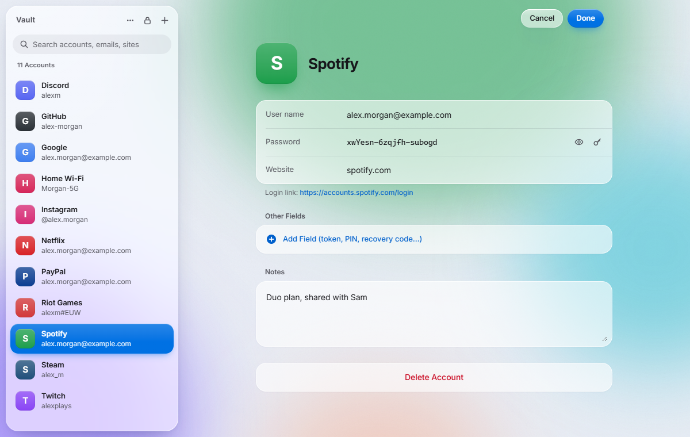
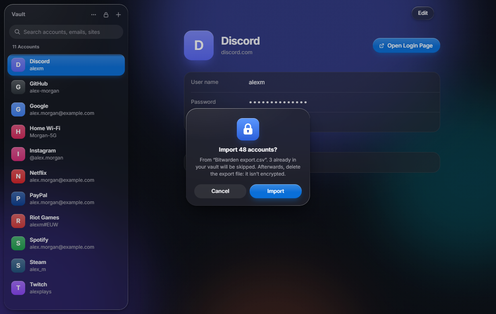

# Vault

A private, offline password manager for Windows, styled after Apple's Liquid Glass design.

<p align="center">
  
</p>

## A look around

<table>
  <tr>
    <td width="50%"></td>
    <td width="50%"></td>
  </tr>
  <tr>
    <td align="center"><b>Dark mode.</b> The background picks up each account's colour.</td>
    <td align="center"><b>Instant search</b> across names, emails, sites and notes.</td>
  </tr>
  <tr>
    <td width="50%"></td>
    <td width="50%"></td>
  </tr>
  <tr>
    <td align="center"><b>Editing.</b> Strong password suggestions, extra fields and a login link made from the site name.</td>
    <td align="center"><b>Import</b> from Apple Passwords, Chrome, Bitwarden, 1Password and more.</td>
  </tr>
  <tr>
    <td colspan="2"></td>
  </tr>
  <tr>
    <td colspan="2" align="center"><b>Locked</b> after 5 minutes idle, or when Windows locks or sleeps.</td>
  </tr>
</table>

<sub>Screenshots use made-up demo accounts. Regenerate them with <code>npm run screenshots</code>.</sub>

## Download

Get the latest version from **[Releases](../../releases/latest)**:

- **Vault-Setup-x.y.z.exe**: installs Vault and keeps it up to date automatically.
- **Vault-Portable-x.y.z.exe**: no install. Keep it on a USB stick; your encrypted vault is stored in a `Vault Data` folder next to it.

Vault isn't code-signed yet, so Windows may say *"Windows protected your PC"* the first time. Click **More info → Run anyway**.

## Features

- Instant search across names, emails, websites and notes
- **Quick search from anywhere**: press <kbd>Ctrl</kbd>+<kbd>Shift</kbd>+<kbd>Space</kbd> in any app, type a few letters and press <kbd>Enter</kbd> to copy the password (<kbd>Shift</kbd>+<kbd>Enter</kbd> user name, <kbd>Alt</kbd>+<kbd>Enter</kbd> 2FA code, <kbd>Ctrl</kbd>+<kbd>Enter</kbd> open the site). Vault keeps running in the notification area when you close the window.
- **Verification codes (2FA)**: paste a site's setup key and Vault shows the live 6-digit code, like an authenticator app
- **Security**: flags weak, reused and year-old passwords, and (only if you turn it on) passwords found in known data breaches
- **Easy password changes**: **Change Password** makes a new password, keeps it on the account as "pending" (saved at once, so nothing is lost if Vault closes), and opens the site's own change page (`/.well-known/change-password`, else a known direct link, else the home page). The browser extension fills the current and the new password when you click **Fill Change Form**; you press the site's save button. Back in Vault, say whether it worked: the new password is kept and the old one goes into the history, or the old one stays.
- **Change queue** in Security: go through every breached, reused, weak and old password one by one, stop any time and continue later
- **Change Email Everywhere** (••• menu): every account on an old email, with a link to each site's email settings and a tick when done (the old email goes into the account's history)
- **Generated email addresses** (••• → Email Addresses): give an account its own address, made as a **one-time inbox** (mail.tm, only for things that don't matter), a **hidden alias** from your own SimpleLogin, addy.io or Firefox Relay account, or an address on **your own domain** (Cloudflare Email Routing and a small Worker that Vault sets up in your account). All their mail shows up inside Vault, in each account and in the **Mail** view, with one-time codes shown big and ready to copy.
- **Favorites** pinned to the top, and **Recently Deleted**: deleted accounts can be recovered for 30 days
- **Password history**: the last 10 passwords of each account are kept when you change it
- User name, password, website, notes, plus your own extra fields (tokens, PINs, recovery codes) that can be hidden like passwords
- Login links made automatically: type `netflix.com` or just "Netflix" and **Open Login Page** opens the sign-in page in your default browser
- Password generator: Apple-style (`xkvbqe-Tmwz4h-pnrcdu`), fully random (length and symbols), or easy-to-type words
- Import from Apple Passwords, Chrome/Edge, Firefox, Bitwarden (CSV/JSON), 1Password, LastPass, Proton Pass, KeePass, Dashlane
- Export to CSV or JSON, and encrypted backup and restore
- **Real site logos** on every account, fetched from each site itself (never through Google or another icon service) and stored encrypted with your vault. The background behind an open account takes the logo's colour. Turn it off in ••• → Download Site Logos.
- Liquid Glass light and motion: light follows the pointer across glass, buttons squish when pressed, glass menus with full keyboard control. With Windows "Show animations" off, only short fades remain.
- **Unlock with a passkey** instead of typing the master password: your phone (QR code, Bluetooth on), Windows Hello PIN or a USB security key. Add or remove them in ••• → Unlock With Passkey.
- **Passkeys for websites**: with the browser extension, Vault can save a site's passkey and sign you in with it (a **Passkeys** view lists them). Vault asks you to confirm every time; **Use Another Device** keeps the browser's own passkey options.
- Light and dark mode, keyboard shortcuts, right-click menus

## Browser extension

Fill logins and use passkeys in Chrome, Edge, Brave or Firefox. The extension keeps no passwords or keys: it asks Vault when you fill or sign in.

1. In Vault, open **••• → Connect a Browser** and click **Show Extension Folder**.
2. **Chrome / Edge / Brave:** open the extensions page (`chrome://extensions`, `edge://extensions`, `brave://extensions`), turn on **Developer mode**, click **Load unpacked** and pick that folder.
   **Firefox:** open `about:debugging#/runtime/this-firefox` and choose **Load Temporary Add-on…** (pick `manifest.json`). Firefox forgets it on restart unless the extension is signed by Mozilla.
3. Click the Vault icon in the browser toolbar and paste the code Vault shows.

Then click the Vault icon on any login page (or press <kbd>Ctrl</kbd>+<kbd>Shift</kbd>+<kbd>L</kbd>) to fill it. When a site offers a passkey, Vault's own window asks you to confirm (unlocking first if needed). The extension folder is refreshed when Vault updates; the browser picks up the new version when it restarts.

How it stays private: the extension reaches Vault through **native messaging**. The browser starts Vault's small relay program (`vault-native-host.exe`), and only for the Vault extension (its id is the only one allowed). The relay passes the messages over a named pipe that only your Windows user can open: there is no network port. On top of that, pairing uses a one-time code shown in Vault, and every message is encrypted (AES-256-GCM) with a key made from that code, time-stamped and single-use. The pairing key is stored with Windows DPAPI. Remove a browser any time in Connect a Browser.

Passkeys for websites: the extension catches `navigator.credentials.create()` / `get()` on https pages and hands the request to Vault, together with the page's origin as the browser reports it (never as the page claims). Vault refuses anything that isn't https, or whose rpId isn't the page's own domain or a parent domain of it (checked against the Public Suffix List, so e.g. `github.io` can't be claimed). It makes an ES256 key, stores it encrypted in the vault (site, account, user handle, credential id, private key, sign counter, date), and signs inside the app; the extension only receives the finished WebAuthn response.

## Security

- Your passwords stay on your computer. Internet requests: the update check against this repository's releases and, unless you turn it off, the site logos. Everything else happens only when you set it up or press its button: opening a site's change-password page (Vault first asks the site whether `/.well-known/change-password` exists), the breach check (only the first 5 characters of each password's SHA-1 hash go to Have I Been Pwned, with padding), and generated email addresses (the services you connect, each with its own key or token, kept only inside the encrypted vault; mail is checked only while Vault is unlocked). A logo is asked from the site itself with only its address: no cookies, no account data. Logos are redrawn as plain images (SVG scripts never run) and cached encrypted with your vault, so the cache doesn't reveal which sites you use. A connected browser talks to Vault over a local named pipe, which never leaves the PC.
- **Vault file**: a random 256-bit vault key encrypts your data with **AES-256-GCM** (a fresh random nonce on every save, the full 128-bit tag always checked). The vault key is stored wrapped by your master password (**scrypt**, N=2¹⁸, r=8, p=1, a fresh random salt) and, for each passkey you add, by a key derived (HKDF-SHA256) from that passkey's WebAuthn **PRF** output. Each wrapped box is tied to its role, so boxes can't be swapped. Saves go to a temp file that is flushed to disk and then renamed, so a crash never leaves half a vault; `vault.json.bak` is the previous (encrypted) version. Vaults from Vault 1.3 and older open as before and are converted on the next unlock; the old file is kept as `vault-v1-backup.json`.
- **Unlocking with a passkey** really decrypts: the passkey's PRF output unwraps the vault key, so there is no "yes/no" unlock that could be skipped. A passkey without PRF is refused when you add it. Changing the master password makes a new vault key, so an old copy of the file plus the old password opens nothing current; your passkeys then have to be added again.
- Why the passkey runs inside Vault's window: Electron's built-in WebAuthn works on Windows (it uses Windows' own `webauthn.dll`, which shows the system dialog: phone by QR code, Windows Hello PIN, security key) as long as the page has a real https origin. Vault's pages are served from `https://vault.localhost/` by an in-app handler (never over the network), so no native add-on is needed.
- **Generated email**: mail is stored encrypted next to the vault (`mail.vault`). HTML mail is cleaned and shown in a sandboxed frame that can't run scripts or load anything from outside (no tracking pictures); every link shows its real address before it opens in your browser. Alias mail is read over IMAP with TLS only, read-only (`EXAMINE`, `BODY.PEEK`): the server searches for the alias headers and Vault downloads only those messages. On your own domain, the Worker encrypts each message at once for Vault (ECDH P-256 + HKDF + AES-256-GCM; Vault keeps the private key), stores only the ciphertext in Workers KV for at most 7 days, and Vault deletes it after fetching. Each address has its own exact routing rule; Vault never turns on a catch-all.
- The master password is never stored. If you forget it, the vault can't be opened (a passkey you added still works).
- Copied passwords and codes are cleared from the clipboard after 30 seconds, or straight away if you quit Vault sooner (only if the clipboard still holds them).
- The quick-search panel and the passkey prompt never see your passwords, 2FA keys or private keys: the main app copies and signs.
- Vault locks after 5 minutes without use, and when Windows locks, sleeps or shuts down. Locking zeroes the key in memory, and every window that showed vault data starts over in a fresh process, so nothing of the vault stays in its memory.
- **Electron hardening**: every window runs with context isolation, sandbox, no Node.js, web security on, and a minimal preload API. Pages are served from Vault's own origin (no `file://`), with a strict Content Security Policy (no eval, no inline or remote scripts). Every IPC call is checked against the one Vault page allowed to make it. Navigation, new windows and `<webview>` are blocked; links open in your browser only if they are https. All permission requests are refused. The built app has hardened Electron fuses (no RunAsNode, no `NODE_OPTIONS`, no `--inspect`, app only from its integrity-checked asar, no extra `file://` privileges) and no DevTools. Vault writes no crash dumps and keeps secrets out of its logs (`update.log`), temp files and settings.

## Building from source

```powershell
npm install
npm start          # run from source
npm run smoke      # automated end-to-end test with screenshots (uses a throw-away vault)
npm run dist       # build the installer and portable .exe into dist/
```

Releasing a new version: raise `version` in `package.json`, then run `.\scripts\release.ps1`.

`VAULT_EXT_E2E=1 npm run smoke` also runs the browser extension in a real Microsoft Edge window, including passkeys on [webauthn.io](https://webauthn.io).

The smoke test runs every outside service as a local test server, and the Cloudflare Worker with Cloudflare's own `wrangler dev`. `VAULT_REAL_MAIL=1 npm run smoke` also checks the real services (see `scripts/real-mail.js` for the keys it reads from the environment).

## Credits

Inter typeface by Rasmus Andersson, used under the SIL Open Font License 1.1 (see `src/fonts/OFL-Inter.txt`).

Word passwords use the [EFF Short Wordlist](https://www.eff.org/dice) by the Electronic Frontier Foundation, CC BY 3.0 US.

One-time inboxes by [mail.tm](https://mail.tm). Breach check by [Have I Been Pwned](https://haveibeenpwned.com/Passwords). Mail parsing by [postal-mime](https://github.com/postalsys/postal-mime) (MIT).
