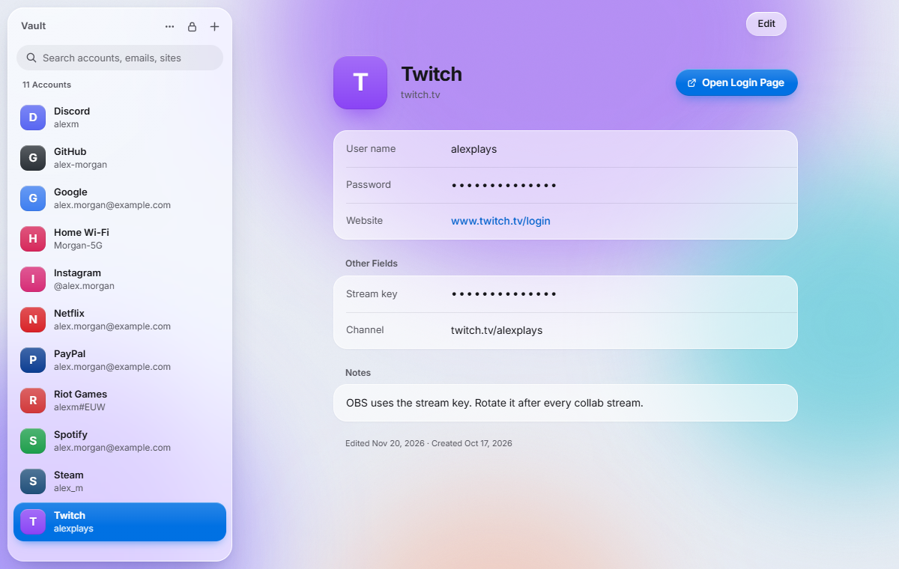
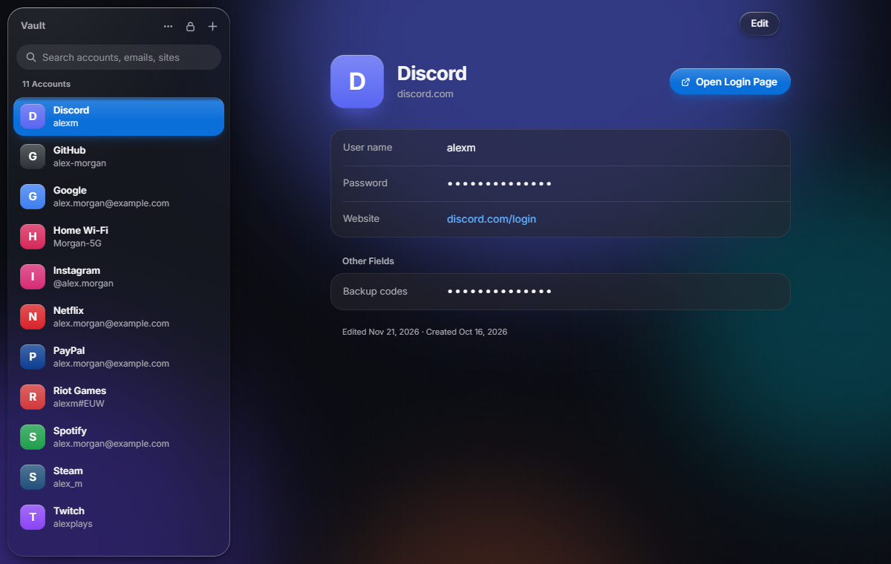
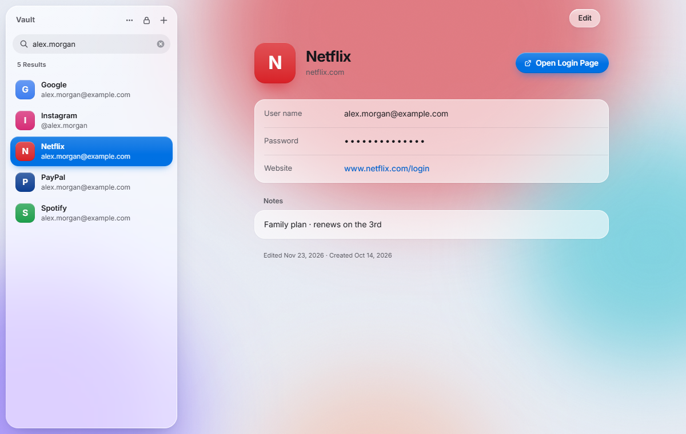

# Vault

A private, offline password manager for Windows, styled after Apple's Liquid Glass design.

<p align="center">
  
</p>

## A look around

<table>
  <tr>
    <td width="50%"></td>
    <td width="50%"></td>
  </tr>
  <tr>
    <td align="center"><b>Dark mode.</b> The background picks up each account's colour.</td>
    <td align="center"><b>Instant search</b> across names, emails, sites and notes.</td>
  </tr>
  <tr>
    <td width="50%"></td>
    <td width="50%"></td>
  </tr>
  <tr>
    <td align="center"><b>Editing.</b> Strong password suggestions, extra fields and a login link made from the site name.</td>
    <td align="center"><b>Import</b> from Apple Passwords, Chrome, Bitwarden, 1Password and more.</td>
  </tr>
  <tr>
    <td colspan="2"></td>
  </tr>
  <tr>
    <td colspan="2" align="center"><b>Locked</b> after 5 minutes idle, or when Windows locks or sleeps.</td>
  </tr>
</table>

<sub>Screenshots use made-up demo accounts. Regenerate them with <code>npm run screenshots</code>.</sub>

## Download

Get the latest version from **[Releases](../../releases/latest)**:

- **Vault-Setup-x.y.z.exe**: installs Vault and keeps it up to date automatically.
- **Vault-Portable-x.y.z.exe**: no install. Keep it on a USB stick; your encrypted vault is stored in a `Vault Data` folder next to it.

Vault isn't code-signed yet, so Windows may say *"Windows protected your PC"* the first time. Click **More info → Run anyway**.

## Features

- Instant search across names, emails, websites and notes
- User name, password, website, notes, plus your own extra fields (tokens, PINs, recovery codes) that can be hidden like passwords
- Login links made automatically: type `netflix.com` or just "Netflix" and **Open Login Page** opens the sign-in page in your default browser
- Strong password suggestions (`xkvbqe-Tmwz4h-pnrcdu` style)
- Import from Apple Passwords, Chrome/Edge, Firefox, Bitwarden (CSV/JSON), 1Password, LastPass, Proton Pass, KeePass, Dashlane
- Export to CSV or JSON, and encrypted backup and restore
- Light and dark mode, keyboard shortcuts, right-click menus

## Security

- Everything stays on your computer; nothing is sent anywhere. The only network request is the update check against this repository's releases.
- The vault file is encrypted with **AES-256-GCM** using a key derived from your master password with **scrypt** (N=2¹⁷, r=8, p=1).
- The master password is never stored. If you forget it, the vault can't be opened.
- Copied passwords are cleared from the clipboard after 30 seconds.
- Vault locks after 5 minutes of inactivity, and when Windows locks or sleeps.
- The app runs with context isolation, a sandboxed renderer, a strict Content Security Policy, and hardened Electron fuses.

## Building from source

```powershell
npm install
npm start          # run from source
npm run smoke      # automated end-to-end test with screenshots (uses a throw-away vault)
npm run dist       # build the installer and portable .exe into dist/
```

Releasing a new version: raise `version` in `package.json`, then run `.\scripts\release.ps1`.

## Credits

Inter typeface by Rasmus Andersson, used under the SIL Open Font License 1.1 (see `src/fonts/OFL-Inter.txt`).
